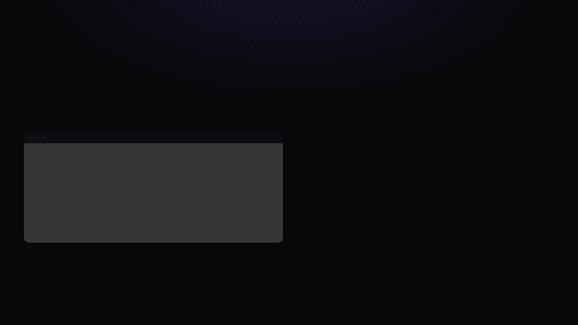
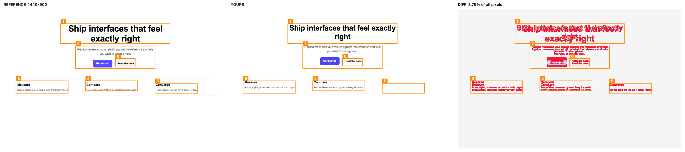
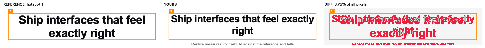
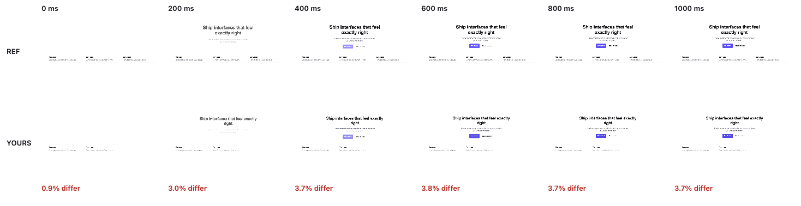

# Replica

**Rebuild any UI from a reference, and prove it with a score.**

Replica is an [Agent Skill](https://agentskills.io) for Claude Code and other coding agents. You point your agent at a live site, a local page, a screenshot or a screen recording. The agent rebuilds that UI in your own codebase, then Replica measures the rebuild against the reference and scores it on four axes: layout, style, pixels and motion. The agent keeps going until the score passes, so "close enough" is a number rather than a judgement call.

[](.github/assets/demo.mp4)

<sub>25 seconds. The reference is the animated hero of [endcap.design](https://endcap.design), an Awwwards nominee, shown to demonstrate. Every score, screenshot and animation frame comes from real Replica runs; findings are trimmed to fit. [Watch with sound (MP4)](.github/assets/demo.mp4).</sub>

## Why

Agents are good at writing UI and bad at checking it. They glance at a screenshot, write something plausible, and say they're done. The font size is 8px off, the stagger is wrong, the easing is linear, and nobody can say by how much.

Replica gives the agent what a careful frontend engineer would gather:

- **A blueprint instead of raw HTML.** The rendered page becomes a compact spec an LLM can read: design tokens, an outline of every visible element with exact boxes and computed styles, what changes per breakpoint, and a motion timeline with fitted easings.
- **A score that can't be talked around.** `compare` exits non-zero until every gated axis passes at the chosen level.
- **Fixes ranked by what they're worth.** Each finding says what is wrong, by how much, and how many points fixing it gains. It also traces root causes ("9 elements sit 16px too high — likely cause: the h1 is 16px shorter because its font-size is 48, not 56").

## What it measures

| axis | how |
|---|---|
| **layout** | Every visible element in the reference is paired with its counterpart in your build, regardless of markup. Each box is checked within a tolerance of a few pixels. |
| **style** | Computed font family, size, weight, line-height, letter-spacing, colours, backgrounds, borders, radii, shadows, opacity and filters, pair by pair. |
| **pixels** | A perceptual (YIQ) diff that tolerates anti-aliasing, with hotspots tied back to the elements under them. |
| **motion** | Every moving element is broken into segments: when it starts, how long it lasts, how far it goes, and the curve's shape (named easing, fitted cubic-bezier, or spring stiffness and damping). |

### Built to be fair to your code

- **Markup-agnostic.** `<a><span>Go</span></a>` equals `<a>Go</a>`. A painted wrapper equals an element that paints itself. An inset `box-shadow` ring equals a `border`. A white background on a white page counts as nothing. Your clone can use any framework, class names or component structure.
- **Nested motion counted once.** When a card springs in, everything inside it moves too. That is one finding on the card ("12 elements inside move with it… fix it here and they follow"), not twelve. A child's own motion (a stagger, a pop, a spin) is still checked on its own.
- **Placeholders don't count against you.** Mark a stand-in for an asset you can't reuse with `data-replica="placeholder"`. Its box is still checked; its pixels are left out of the pixel score and listed in the report.
- **Technique-agnostic motion.** A CSS `@keyframes` reference and a Web Animations API or Framer Motion clone with the same timing score 100.
- **Deterministic.** Pages run on a virtual clock with frozen CSS timelines, a seeded `Math.random`, and fixed time, locale and DPR. Stills are shot from the viewport, not a full-page resize that makes some sites re-lay out. Capturing a live, animated production site twice gives a 100/100 match, so every difference is real.

## Install

With the open [`skills`](https://github.com/vercel-labs/skills) CLI:

```bash
npx skills add albertirgi/replica
```

Or by hand: copy `skills/replica` into your agent's skills folder (for Claude Code, `~/.claude/skills/replica` or `.claude/skills/replica` in a project). Then install its one dependency:

```bash
npm install --prefix ~/.claude/skills/replica/scripts
node ~/.claude/skills/replica/scripts/replica.mjs doctor
```

Requirements: Node 20+. Replica uses Playwright's Chromium, or falls back to an installed Google Chrome. `ffmpeg` is needed only for video and GIF references. No API keys.

## Use

Ask your agent in plain language:

> Rebuild the hero from https://example.com in `app/page.tsx` with our copy. Faithful level.

> Make the pricing card hover feel exactly like stripe.com's — pixel-perfect.

> Here's a screen recording of the menu opening (`menu.mov`). Build it in `components/Menu.tsx`.

The skill makes the agent:

1. **Scope**: work out the target, destination, level and trigger.
2. **Capture** the reference into `.replica/<name>/ref/`: `blueprint.md`, screenshots per viewport, motion frames and a filmstrip.
3. **Build** from measurements, in your existing stack.
4. **Compare, fix, repeat**: each round writes `report.md`, `issues.json` and comparison sheets. The agent fixes the highest-value findings first and stops when the score passes, or after 8 rounds with an honest account of what's left.

### Levels

| level | for | gates |
|---|---|---|
| `structure` | same layout and motion, your own brand and content | layout ≥ 90 · motion ≥ 85 |
| `faithful` (default) | "clone this" | layout ≥ 95 · style ≥ 95 · pixels ≥ 85 · motion ≥ 90 |
| `exact` | "pixel-perfect", "1:1" | layout ≥ 98 · style ≥ 98 · pixels ≥ 97 · motion ≥ 95 |

### What a report looks like

From the self-test, comparing a clone with five planted bugs:

```
# Replica · round 1 · level `faithful`
**Score 79.8 — NOT YET ✗**
| layout 63.7 ✗ | style 94.8 ✗ | pixels 71.2 ✗ | motion 89.6 ✗ |

## Fix next (highest gain first)
1. missing · div .card with 2 things inside (h3 "Converge", p "Fix the top…") has no counterpart in yours. (+22.4 layout)
2. layout · 9 elements sit 16px too high, starting at p "Replica measures…". Likely cause: h1 "Ship interfaces…"
   is 16px shorter than the reference (font-size 56 (yours 48) · line-height 64 (yours 56)) — fix that and these follow. (+13.9 layout)
3. motion · p "Replica measures…" — y: lasts 300ms (ref 600ms), curve: ref out-cubic (cubic-bezier(0.33, 1, 0.68, 1)),
   yours linear … (+10.4 motion)
5. style · div .card — border-radius 12px (yours 4px). Same on 1 more: div .card [509,450 421×110]. (+2.4 style)
7. style · a "Get started" — background-color #5b4bff (yours #4f46e5). (+0.7 style)
```

Each round also writes comparison sheets: the reference, yours and the diff, with numbered hotspots.



Hotspots are zoomed, and motion is compared frame by frame:




## CLI

The agent drives this, but you can run it yourself:

```bash
node skills/replica/scripts/replica.mjs capture <url|file.html|image|video> --out .replica/hero/ref \
  [--selector "#hero"] [--viewports 1440x900,390x844] [--action load|reveal|hover:<css>|click:<css>|scroll:<px>|scrub:<px>] \
  [--motion 1500] [--fps 30] [--level structure|faithful|exact] [--hide "<css>"] [--storage auth.json]

node skills/replica/scripts/replica.mjs compare .replica/hero/ref http://localhost:3000 [--selector "#my-hero"]
```

`compare` exits `0` on a pass, `1` when it hasn't passed yet, and `2` on error. Run `--help` for every option.

## Limits

- Web UI only. Native mobile isn't covered.
- Stills stop at 8000px tall. Capture long pages section by section with `--selector`.
- `<video>` elements are frozen on their first frame. Canvas and WebGL are judged by pixels and motion frames only.
- Streaming links (YouTube, Loom) can't be fetched. Use a screen recording.
- The reference's fonts, images, icons and copy belong to their owners. The skill tells the agent to use your assets, or placeholders, unless you have the rights.

## Development

```bash
cd skills/replica/scripts && npm install && npm test
```

The self-test captures three fixture pages and compares clones against them.

- **A hero section.** The reference itself must score exactly 100. A clone with different markup and JS-driven animations must pass `faithful`. A clone with five planted bugs must fail, and the report must name every one.
- **An animated deploy card.** It has a spring, staggered rows, popping dots, a 360° spin, a growing bar and a colour change. The blueprint must read each one back exactly as authored (the spring's stiffness to within a few percent). A clone rebuilt from the report must pass. A clone with generic easing must fail, with the spring reported once and the missing spin named.
- **A section under a header that compacts on resize.** A clone with a placeholder where the artwork was must score 100 on pixels: the still fires no resize, and the placeholder is left out.

## Acknowledgements

Inspired by [reanimate](https://github.com/NiazMorshed2007/reanimate), which showed that measuring a clone frame by frame beats eyeballing it.

## License

MIT
